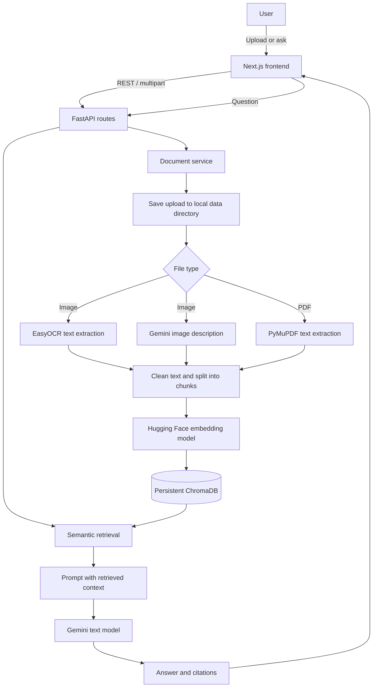

# RAG-Assistant

RAG-Assistant is a document research workspace. Upload PDFs or images, then ask questions against the indexed content. The FastAPI backend extracts text, creates embeddings, searches a persistent ChromaDB collection, and sends relevant passages to Google Gemini to generate answers with source citations.

The repository contains a Next.js web application and the existing Python RAG backend. The browser frontend calls the backend REST API directly.

## Features

- Upload one or more PDF files and images (`.png`, `.jpg`, `.jpeg`, `.bmp`, `.tiff`).
- Extract text from text-based PDFs with PyMuPDF. OCR image uploads with EasyOCR and request a Gemini image description.
- Split extracted content into overlapping chunks, embed it locally, and persist it in ChromaDB.
- Ask questions across the indexed library and receive answers with source filename, page, and passage citations.
- Search and inspect retrieved passages without generating an answer.
- Generate document summaries, compare two documents, and create study notes in several formats.
- Browse and permanently delete uploaded PDFs/images and their indexed chunks, use a responsive Next.js interface, switch themes, and start a fresh in-page conversation.

## Technology

| Area | Implementation |
| --- | --- |
| Frontend | Next.js App Router, React, TypeScript |
| API | Python 3.10, FastAPI, Uvicorn |
| RAG integrations | LangChain Core, text splitters, Chroma, Hugging Face embeddings, Google GenAI integration |
| Answer model | Google Gemini; default `gemini-2.5-flash` |
| Embedding model | `sentence-transformers/all-MiniLM-L6-v2`, loaded on CPU by default |
| Vector store | Persistent ChromaDB collection `multimodal_rag` |
| PDF processing | PyMuPDF (`fitz`) |
| Image processing | OpenCV and EasyOCR; Gemini is also used to describe image uploads |
| Containers | Docker Compose, Python 3.10 and Node.js 20 images |

The embedding model is downloaded from Hugging Face on first use. EasyOCR may download model weights when image OCR is first used. Gemini generation requires network access and a configured API key.

## Architecture

The frontend handles user interaction and sends HTTP requests to FastAPI. The backend validates and saves each upload, processes it immediately, and writes chunks and metadata to a persistent ChromaDB collection. For questions, the backend embeds the query, retrieves the nearest chunks, builds a prompt with that context, calls Gemini, and returns the response and citations.



**Component responsibilities**

- **Next.js frontend:** uploads documents, calls backend endpoints, shows indexed documents, answers, citations, search results, summaries, comparisons, and notes.
- **FastAPI backend:** validates requests, routes API operations, and coordinates document, retrieval, and generation services.
- **Document pipeline:** saves uploads; extracts PDF text or image OCR/description; cleans and chunks text.
- **Embedding model:** maps chunks and user questions to vectors locally so semantically related text can be found.
- **ChromaDB:** stores chunk text and source metadata in the configured persistent directory.
- **Retrieval and Gemini:** nearest chunks are placed in a prompt for Gemini; citations are built from the retrieved chunk metadata.

## Repository layout

```text
.
├── backend/
│   ├── api/                 FastAPI upload, query, health, summary, compare, and notes routes
│   ├── core/                Environment configuration, constants, and logging
│   ├── data/                Runtime upload and processing directories (created as needed; ignored)
│   ├── models/              Pydantic request and response schemas
│   ├── prompts/             Prompt templates for RAG, summaries, comparisons, and notes
│   ├── services/            PDF/image processing, document handling, embeddings, retrieval, Gemini, and features
│   ├── utils/               File management, text cleanup, and chunk creation
│   ├── vectorstore/         ChromaDB collection management
│   ├── .env.example         Backend configuration template
│   ├── Dockerfile           Backend container image
│   ├── main.py              FastAPI application and local Uvicorn entry point
│   ├── requirements.txt     Local Python dependencies
│   └── requirements-docker.txt  Container dependencies (CPU PyTorch installed separately)
├── frontend/
│   ├── app/                 Next.js page, layout, and global styles
│   ├── lib/api.ts           Typed client for the FastAPI endpoints
│   ├── public/              Static assets (currently only a placeholder)
│   ├── .env.example         Frontend API URL template
│   ├── Dockerfile           Multi-stage Next.js container build
│   ├── next.config.ts       Standalone production output configuration
│   ├── package.json         Frontend scripts and dependencies
│   └── package-lock.json    Locked npm dependency tree
├── docker-compose.yml       Backend and frontend services, ports, health check, and data mounts
├── .gitignore               Local secrets, environments, caches, and generated data exclusions
└── README.md                This guide
```

There is no committed test directory, sample document, or model asset. Runtime data and downloaded model weights are not committed.

## Prerequisites

Required for local development:

- Git.
- Python 3.10 (the backend Docker image uses Python 3.10; using the same version locally avoids compatibility differences).
- Node.js 20 or newer and npm (the frontend Docker image uses Node.js 20).
- A Gemini API key for generated answers, summaries, comparisons, notes, and image descriptions.
- Network access on first use to download Python packages and Hugging Face/EasyOCR model weights.

Docker Desktop or Docker Engine with the Compose plugin is optional when running the two services directly. Image OCR and local embeddings run on CPU by default and can take time on first initialization.

## Local setup

Run the backend and frontend in separate terminals. Start the backend first.

### 1. Clone the repository

```bash
git clone https://github.com/Samarth201104/RAG-Assistant.git
cd RAG-Assistant
```

### 2. Configure and start the backend

The backend reads `backend/.env` when it starts. Copy the template and set `GEMINI_API_KEY` in that file.

**Windows PowerShell** (from the repository root):

```powershell
Set-Location backend
Copy-Item .env.example .env
py -3.10 -m venv .venv
.\.venv\Scripts\Activate.ps1
python -m pip install --upgrade pip
pip install -r requirements.txt
```

Edit `backend/.env` and replace the example Gemini key. Then start the backend, still from `backend/`:

```powershell
python main.py
```

**Linux or macOS** (from the repository root):

```bash
cd backend
cp .env.example .env
python3.10 -m venv .venv
source .venv/bin/activate
python -m pip install --upgrade pip
pip install -r requirements.txt
```

Edit `backend/.env` and replace the example Gemini key, then run from `backend/`:

```bash
python main.py
```

The API listens on `http://127.0.0.1:8000` by default. The interactive API reference is at `http://127.0.0.1:8000/docs`. The backend uses the `PORT` environment variable if set.

### 3. Configure and start the frontend

In a second terminal opened at the repository root, change into `frontend/`. The committed example points the browser to the local backend.

**Windows PowerShell:**

```powershell
Set-Location frontend
Copy-Item .env.example .env.local
npm ci
npm run dev
```

**Linux or macOS:**

```bash
cd frontend
cp .env.example .env.local
npm ci
npm run dev
```

Open `http://localhost:3000`. If the backend is at another address, set `NEXT_PUBLIC_API_URL` in `frontend/.env.local` to the backend origin, then restart the Next.js process. This variable is public and must not contain secrets.

### 4. Run with Docker Compose (optional)

Create and configure `backend/.env` as described above, then run Compose from the repository root:

```bash
docker compose up --build
```

The UI is available at `http://localhost:3001`; FastAPI is at `http://localhost:8000` and its docs at `/docs`. Compose waits for the backend health check before starting the frontend. The backend's upload data, logs, and Chroma directory are mounted from `backend/` on the host so they persist across container restarts.

The browser frontend needs a URL it can reach. Compose builds the frontend with `NEXT_PUBLIC_API_URL=http://localhost:8000` by default. To use a different browser-visible backend address, set `NEXT_PUBLIC_API_URL` in the environment that launches `docker compose` before building, because Next.js embeds this public value into the frontend build.

Useful Compose commands:

```bash
docker compose logs -f
docker compose down
```

## Configuration

### Backend environment variables

Create `backend/.env` from `backend/.env.example`. The `.env` file is local configuration and must not be committed.

| Variable | Required | Default | Purpose |
| --- | --- | --- | --- |
| `GEMINI_API_KEY` | Yes for Gemini features | — | Authenticates Gemini requests. |
| `GEMINI_MODEL` | No | `gemini-2.5-flash` | Gemini model used for text generation and image descriptions. |
| `TEMPERATURE` | No | `0.2` | Generation temperature. |
| `MAX_OUTPUT_TOKENS` | No | `2048` | Maximum output tokens configured for Gemini. |
| `EMBEDDING_MODEL` | No | `sentence-transformers/all-MiniLM-L6-v2` | Hugging Face embedding model ID. |
| `CHROMA_DB_PATH` | No | `backend/vectordb` locally | Persistent ChromaDB directory. |
| `CHUNK_SIZE` | No | `1000` | Character-based chunk target size. |
| `CHUNK_OVERLAP` | No | `200` | Overlap between adjacent chunks. |
| `TOP_K` | No | `5` | Default number of retrieved chunks. Query requests allow 1–20. |
| `UPLOAD_PDF_DIR` | No | `backend/data/uploads/pdfs` | Saved PDF files. |
| `UPLOAD_IMAGE_DIR` | No | `backend/data/uploads/images` | Saved image files. |
| `PROCESSED_DATA_DIR` | No | `backend/data/processed` | Processed data directory. |
| `TEMP_DIR` | No | `backend/data/temp` | Temporary data directory. |
| `LOG_LEVEL` | No | `INFO` | Backend log level. |
| `PORT` | No | `8000` | Local Uvicorn port when starting with `python main.py`. |

In Docker, the Compose mounts and Docker working directory make the data and vector-store defaults resolve under `/app` in the container.

Create a Gemini API key through [Google AI for Developers](https://ai.google.dev/gemini-api/docs/api-key). Keep it in `backend/.env`, never in frontend variables, source control, or issue reports. Gemini access is subject to provider availability, quotas, and pricing; check the provider's current terms for your account.

### Frontend environment variable

| Variable | Default | Purpose |
| --- | --- | --- |
| `NEXT_PUBLIC_API_URL` | `http://127.0.0.1:8000` | Backend origin called by the browser. It is public by design. |

## Using the application

1. Open `http://localhost:3000` for local development or `http://localhost:3001` for Compose.
2. Open **Documents**, choose files or drag them into the upload area. The UI accepts PDF, PNG, JPG/JPEG, BMP, and TIFF files and allows multiple files in one upload.
3. Upload triggers processing immediately: PDF text extraction or image OCR/description, chunking, embedding, and insertion into ChromaDB.
4. Use **Research assistant** to ask a question across the indexed library. Answers display source filename, page, and passage metadata returned by the backend. The conversation is held in the current page state; **New conversation** clears it.
5. Use **Semantic search** to retrieve passages without asking Gemini to generate an answer.
6. Use **Summarize**, **Compare**, or **Study notes** for document-level generation. Study-note formats exposed by the UI are detailed, short, flashcards, interview, MCQ, revision, cheatsheet, mindmap, FAQ, and exam.
7. In **Documents**, choose the delete action to remove the document's chunks from ChromaDB and permanently delete its uploaded PDF/image from backend storage. The frontend removes it from the visible library after the backend confirms deletion.

Try questions such as “What are the main findings?”, “Which limitations do the authors discuss?”, or “What method did the paper use?”. Ask focused questions for better retrieval.

### API endpoints

The frontend uses these backend routes:

| Method | Route | Purpose |
| --- | --- | --- |
| `GET` | `/health` | Basic service health. |
| `POST` | `/upload/pdf`, `/upload/image` | Save, process, and index uploaded files (`files` multipart field). |
| `GET` | `/upload/pdfs`, `/upload/images` | List original uploads by type. |
| `GET` | `/upload/documents` | List documents represented in ChromaDB. |
| `DELETE` | `/upload/document/{filename}` | Remove a document's vectors and uploaded file from backend storage. |
| `POST` | `/query` | Ask across indexed documents. |
| `POST` | `/query/retrieve` | Retrieve relevant passages without generation. |
| `POST` | `/summarize` | Summarize an indexed document. |
| `POST` | `/compare` | Compare two indexed documents. |
| `POST` | `/notes` | Generate a selected study-note format. |

FastAPI's full route list, including additional specialized summary, notes, and comparison operations, is available at `/docs`.

Supported extensions are checked by filename. The code does not define an explicit upload size or document-count limit. Large files can therefore consume substantial memory and processing time.

## RAG pipeline details

1. **Ingestion:** the upload route calls the document service during the upload request. Files are saved with a generated unique filename in the PDF or image upload directory.
2. **Extraction:** PyMuPDF extracts text page by page from PDFs. Image files are processed using EasyOCR in English, and Gemini generates an image description. Scanned PDFs do not currently receive OCR in the PDF path.
3. **Cleaning and chunking:** text cleanup runs before the LangChain recursive character splitter creates chunks. The defaults are 1,000 characters with 200 characters of overlap. PDF chunks retain page metadata; image chunks use page 1.
4. **Embedding:** `sentence-transformers/all-MiniLM-L6-v2` creates normalized vectors on CPU. The model is downloaded/cached by the Hugging Face libraries on first use.
5. **Persistence:** vectors, text, and source metadata go into the `multimodal_rag` Chroma collection. Chroma uses `CHROMA_DB_PATH`, so the index can persist across backend restarts when that directory is retained.
6. **Retrieval:** a user question is embedded and Chroma returns nearest chunks. The default `top_k` is 5; the query endpoint accepts values from 1 to 20.
7. **Generation:** the backend places retrieved text and metadata into the RAG prompt and calls the configured Gemini model. The API returns an answer, retrieved chunk count, and source citations derived from metadata.

Retrieval quality depends on extraction quality, chunk size and overlap, embedding suitability, and the number of retrieved chunks. Chunks that are too small may lose context; chunks that are too large may dilute the relevant passage. OCR mistakes, missing PDF text layers, or a poor question can also lead to weak or empty results. RAG can still produce inaccurate answers, so check the cited passages against the source document.

## Troubleshooting

- **Gemini requests fail:** confirm `GEMINI_API_KEY` is set in `backend/.env`, restart FastAPI after editing it, and check the key, model availability, account quota, and provider status.
- **Backend cannot start:** activate the backend virtual environment, install `backend/requirements.txt`, and run `python main.py` from inside `backend/`. The documented baseline is Python 3.10.
- **Frontend says the service is unavailable:** confirm FastAPI responds at `http://127.0.0.1:8000/health`. Check `NEXT_PUBLIC_API_URL`; after editing `.env.local`, restart Next.js.
- **Port is already in use:** stop the process using the port or set backend `PORT` for local FastAPI. The Next.js development server can select a different available port, but use that displayed address to open it.
- **Docker Compose frontend cannot reach the backend:** set `NEXT_PUBLIC_API_URL` to an address reachable from the user's browser before building the frontend image. A container-only hostname such as `backend` is not a browser URL.
- **Upload is rejected:** verify the filename extension is `.pdf`, `.png`, `.jpg`, `.jpeg`, `.bmp`, or `.tiff`. The backend validates extension rather than inspecting file content.
- **Scanned PDF has no useful text:** PDF processing currently extracts the PDF text layer and does not OCR scanned pages. Use an OCR-processed/searchable PDF or add PDF OCR support.
- **First image upload is slow or fails:** EasyOCR loads lazily and may download weights on first use; check network access and available RAM/disk space.
- **First embedding request is slow or fails:** the Hugging Face embedding model must be downloaded and loaded locally. Check network access, model cache space, and memory.
- **No relevant passages or weak answers:** confirm the document appears in the indexed library, ask using terms found in the document, and inspect results in Semantic search. Changing chunk or `TOP_K` settings changes indexing/retrieval behavior; re-upload documents after changing chunk settings.
- **Compose reports a missing env file:** create `backend/.env` from `backend/.env.example` before running Compose.

## Limitations and possible improvements

Current implementation limitations:

- PDF extraction depends on a text layer; there is no PDF OCR fallback.
- EasyOCR is configured for English only. Image processing also calls Gemini for a description.
- Uploaded originals and Chroma vectors are stored locally; there is no remote object store or multi-user document isolation in this repository.
- Deleting a document removes both its Chroma vectors and uploaded original; keep separate backups if the original must be retained.
- No explicit upload size/count limit is enforced in the application code.
- Gemini availability, quota, and latency affect generation features. Local embedding and OCR can be resource-intensive.
- The backend currently allows CORS requests from any origin. This is permissive and should be restricted before exposing the API publicly.
- The frontend conversation is in-memory and is cleared by reload or **New conversation**.

Possible future work includes OCR for scanned PDFs, explicit upload limits, file deletion controls with clear semantics, persistent conversation history, configurable CORS origins, and automated backend/API integration tests. These are not represented as implemented features.

## Testing and development

No automated test suite or test configuration is currently committed. The backend's interactive OpenAPI page at `http://127.0.0.1:8000/docs` can be used for manual endpoint checks. For a manual end-to-end check, start both services, upload a small text-based PDF, verify it appears in **Documents**, search for a distinctive phrase, ask a question, and confirm returned citations refer to the uploaded file.

Frontend scripts are listed in `frontend/package.json`:

```bash
npm ci
npm run dev
npm run build
npm run start
```

`npm run start` serves the standalone production build and requires `npm run build` first. For local backend startup, run `python main.py` from `backend/` after installing its requirements and configuring the environment.

## Contributing

1. Fork the repository and create a focused feature branch.
2. Make a scoped change and update relevant documentation or configuration.
3. Run the available checks (currently there is no committed automated test suite; at minimum build the frontend and manually exercise affected API behavior).
4. Open a pull request describing the change and the checks performed.
